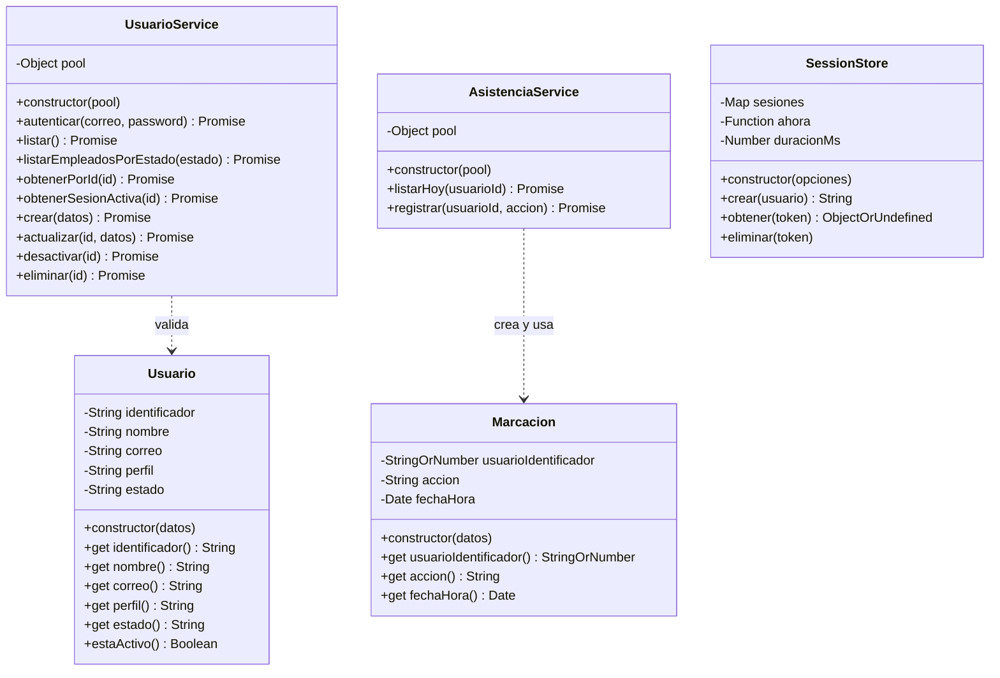

# Sprint 05 — Correctivos POO

**Estado:** Listo para revisión de los bloques aprobados; sin merge
**Rama:** `sprint/05-correctivos-poo`
**Base estable:** `main` en `75e5e280695f4274d7b859b87326e78ba7e4e3f8`.
**Autorización:** correctivos de auditoría aprobados por el responsable el 04-10-2026; implementación secuencial y documentada.

## Objetivo y límites

Corregir los defectos confirmados de sesiones, formulario y POO manteniendo los ocho requisitos, stack, esquema y alcance de segundo año. No agregar funcionalidades ni reinterpretar RE-03. Main y Sprint04 se conservan como referencia histórica; no hacer merge sin revisión.

## Bloques secuenciales

0. Fijar este contrato y las decisiones en la especificación canónica antes de código.
1. **Seguridad básica:** vencimiento servidor de ocho horas; revalidación de estado/perfil del usuario en cada petición autenticada; logout efectivo; ID validado y atributo HTML seguro. Regresiones de sesión desactivada, eliminada, cambio de perfil, caducidad y marcado externo. Reutilizar workflow existente agregando únicamente esta rama a su disparador push para validar Node20/MySQL8.4.
2. **POO y contratos:** estado privado y getters de lectura en Usuario/Marcacion; copia defensiva de fecha y sesión; Marcacion utilizada en registrar; entradas obligatorias y longitudes coherentes con schema. Mantener API de lectura actual; no añadir setters ni jerarquías artificiales.
3. **Documentación y validación:** registrar resultados reales en este archivo y plan de pruebas; contrastar API de clases mediante un diagrama Mermaid en este archivo; actualizar README/trazabilidad necesarios. Revisar diff completo y entregar rama/commits/pruebas/pendientes.

Cada bloque se prueba antes de su commit. Si falla una regresión, no se avanza hasta resolverla. Todos los bloques pertenecen a esta única fase; no se abre otro sprint.

## Riesgos y contención

- Middleware asíncrono: verificar que un fallo de BD no permita acceso ni deje petición abierta.
- Modelo encapsulado: conservar getters usados por servicios/pruebas; no cambiar columnas ni seed.
- Formularios: comprobar recuperación de errores y operaciones CRUD normales.
- Reversión: commits separados por bloque; detenerse antes de merge. Un rollback se prepara como revert del bloque, nunca force-push ni borrado de datos.

## Pruebas exigidas

- npm ci y TZ=America/Santiago npm test.
- npm run test:db en MySQL8.4 y arranque mediante workflow existente sobre el SHA de esta rama.
- Regresiones HTTP con dobles y casos de modelos/sesiones; integración de sesión vigente y CRUD en BD real.
- Docker Compose y demostración manual: registrar como pendientes si no se ejecutan; no sustituir por CI.

## Pendientes fuera de estos bloques

- Carrera de medianoche detectada en auditoría: requiere corrección y prueba MySQL específica antes de declararla cerrada; no se añade una transacción nueva sin verificar necesidad.
- Clasificación/exposición de errores y protección CSRF: quedan registradas para un bloque posterior aprobado; no mezclar una refactorización de todas las rutas con los dos bloqueos iniciales.
- Coste criptográfico y decisión de administrador en RE-03: no cambiar en esta fase.

## Resultado

- Bloque0: contrato fijado en commit c1be33b58042fd02f7ff168f686c6aa390cd94dc.
- Bloque1: sesiones con vencimiento de ocho horas, estado/perfil vigente por petición y eliminación del token inválido; Map privado y copia de sesión. ID validado y URL/atributo codificados; body.id descartado al recuperar formulario de creación.
- Pruebas locales: npm ci correcto; TZ=America/Santiago npm test 29/29,0 fallos,0 omitidas. Tras completar la aserción HTTP de caducidad, suite de seguridad10/10. Node local24.19.0. COR-10 genera deliberadamente un error interno para comprobar500 genérico; no es un fallo de suite.
- Integración: añadidas aserciones de cookie anterior tras desactivar, cambiar perfil y eliminar; ejecución MySQL pendiente en este punto.
- Diff del bloque revisado: ocho archivos de código/configuración/pruebas; esquema y dependencias conservados.

### Bloque2 — POO y contratos

- Usuario tiene campos #privados y getters sin setters, normaliza texto y correo, rechaza campos obligatorios vacíos/tipos ajenos y longitudes superiores a VARCHAR. validarCorreo tiene una sola implementación en el módulo del modelo; el servicio conserva su exportación anterior por compatibilidad.
- Marcacion protege identidad/acción/fecha; fechaHora entrega una copia y el constructor copia la fecha recibida. AsistenciaService.registrar crea y usa Marcacion para validar y persistir identidad/acción. MySQL sigue fijando la fecha guardada mediante NOW(); fechaHora del objeto representa el instante de construcción, no una lectura posterior del registro persistido.
- obtenerSesionActiva usa Usuario.estaActivo; los pools de los tres servicios son privados. Se conservan firmas y getters consumidos por el flujo y las pruebas.
- Pruebas locales finales del bloque: TZ=America/Santiago npm test35/35,0 fallos,0 omitidas. Incluye seis casos COR-11 a COR-16; no se añadió dependencia ni se alteró schema/seed.
- Puerta del bloque anterior: run37243041395, SHA f99574cf6e29b612f31234e0eef26d829515d15a, success;29/29 unitarias,4/4 MySQL,0 omitidas y arranque correcto. Integración del bloque2 pendiente hasta su run.

## Clases afectadas y visibilidad

− representa campos #privados; + operaciones públicas. Los miembros get son accesores JavaScript de lectura, sin setters. La flecha punteada representa creación/uso, no herencia.

Diagrama parcial: ReporteService conserva pool privado y métodos asíncronos listarAtrasos, listarSalidasAnticipadas y listarInasistencias. validarCorreo se exporta como propiedad de Usuario y desde usuarioService por compatibilidad. En registrar, usuarioIdentificador recibe el ID interno; NOW de MySQL fija fecha persistida. El Date del modelo indica su construcción, no una lectura del registro guardado.

## Resultado final de los bloques aprobados

- Bloques0,1 y2 completados en commits separados; bloque3 documenta resultados, trazabilidad y clases.
- GitHub Actions [run 37243366141](https://github.com/aik1a/Proyecto-1-Integracion-CompetenciasII/actions/runs/37243366141), SHA `d852d630406b21df9b8343533cccd474450b0715`, rama `sprint/05-correctivos-poo`: 35/35 unitarias, 4/4 integración MySQL 8.4, 0 fallos, 0 omitidas; schema/seed y arranque correctos en Node 20. Logs comprobados el 04-10-2026.
- Main permanece en la base estable. Schema, seed, lockfile y Dockerfile/Compose conservados. Workflow existente: solo se añadió esta rama a push; sin pipeline nuevo ni despliegue.
- Pendientes: Docker Compose y recorrido manual de esta versión; sincronizar el UML con SVG/DOCX externos antes de entregar. A05 (errores de otras rutas), A07 (medianoche), A09 (CSRF), configuración inválida y coste scrypt abiertos para otro bloque autorizado. No se declara corregida toda la matriz.
- Comparar main con esta rama y revisar antes de merge. Si un bloque requiere reversión, preparar revert de su commit; nunca reset de main ni borrado de volumen/datos.
